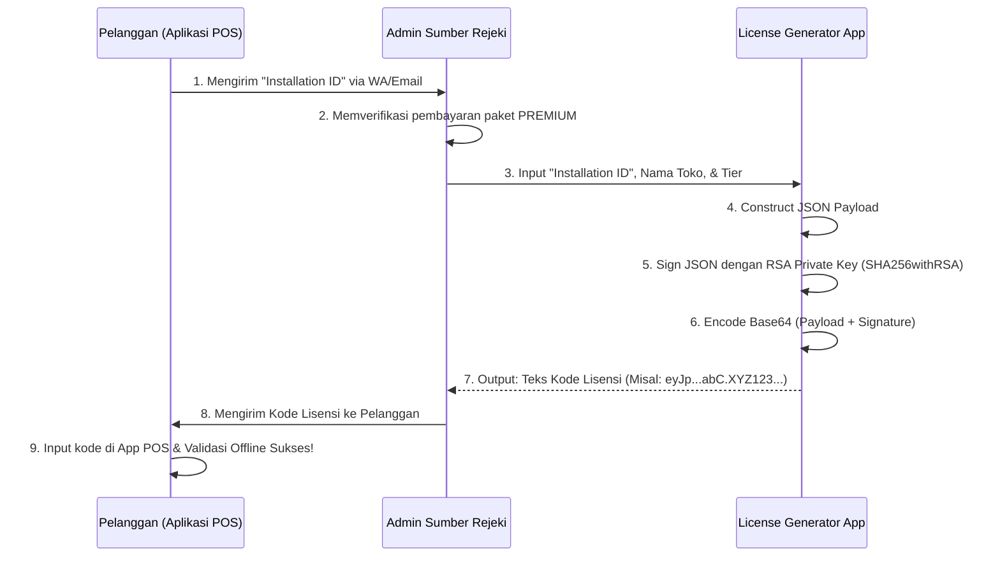

# Build Offline License Key Generator for Sumber Rejeki POS

## 📌 Deskripsi Singkat (Description)
Aplikasi **Sumber Rejeki POS** menggunakan sistem verifikasi lisensi offline berbasis **Kriptografi RSA-2048**. Untuk dapat memberikan lisensi kepada pelanggan secara aman (misalnya saat pelanggan membeli paket PREMIUM), kita membutuhkan sebuah aplikasi mandiri (*License Generator Tool*) yang dipegang khusus oleh Administrator / Pemilik Sistem, bukan diinstal pada aplikasi klien.

Aplikasi Generator ini akan bertugas menerima **Installation ID** dari perangkat pelanggan, lalu menandatanganinya (Signing) menggunakan **Private Key RSA** dan menghasilkan string lisensi dengan format `Base64(JSON_Payload).Base64(Signature)`.

---

## 🎯 Objektif (Objectives)
1. Membuat antarmuka (CLI atau Web Desktop) bagi admin untuk memasukkan data pelanggan.
2. Membaca *Private Key RSA (PKCS#8)* yang diamankan dengan ketat.
3. Menghasilkan struktur JSON Payload yang identik dan tervalidasi dengan Android App (`RsaKeyHelper.kt`).
4. Memudahkan admin meng-copy hasil kode lisensi untuk dikirimkan via WhatsApp atau Email kepada klien (Pemilik Toko).

---

## 🛠️ Struktur Payload & Algoritma
Sistem generator **harus** mengimplementasikan algoritma berikut agar sinkron dengan parser di Android:

- **Algoritma Signature**: `SHA256withRSA`
- **Format Final**: `<Payload_Base64_NoWrap>.<Signature_Base64_NoWrap>`
- **JSON Payload Format**:
  ```json
  {
    "installationId": "A1B2C3D4E5",
    "licensedTo": "Toko Berkah Bersama",
    "tier": "PREMIUM",
    "issuedAt": 1693537200000,
    "expiresAt": 1725169200000 // Optional
  }
  ```

---

## ⚙️ Workflow Operasional (Cara Kerja)



---

## 📂 Rekomendasi Tech Stack & Struktur Proyek
Mengingat Anda membutuhkan mobilitas tinggi (bisa *generate* langsung dari HP tanpa perlu buka laptop/PC), kita akan membuat **Aplikasi Android Mandiri (Standalone Android App)** khusus untuk Admin/Owner.

Aplikasi ini bisa dinamakan **"Sumber Rejeki Admin"** atau **"License Generator"**.

### Tech Stack:
- **Kotlin + Jetpack Compose** (Bisa di-*copy-paste* langsung fungsi `generateLicense` dari `RsaKeyHelper.kt` yang sudah ada di POS).
- **ClipboardManager**: Untuk fitur "Copy to Clipboard" agar lisensi mudah di-paste ke WhatsApp.
- **Biometric Prompt (Opsional)**: Menambahkan keamanan sidik jari/Face unlock sebelum bisa membuka aplikasi dan *generate* lisensi, untuk mencegah orang lain memakai HP Anda.

**Kelebihan Pendekatan Ini:**
1. **Sangat Mobile**: Anda bisa merespons chat pelanggan yang membeli lisensi kapan saja dan di mana saja.
2. **Sepenuhnya Offline**: Tidak perlu server atau koneksi internet.
3. **Kode Reusable**: Logika kriptografinya (`RsaKeyHelper.kt`) 100% sama persis dengan yang ada di aplikasi kasir utamanya.

---

## ✅ Kriteria Penerimaan (Acceptance Criteria)
- [ ] Generator dapat berjalan secara offline di mesin Admin.
- [ ] Mampu mem-paste `private_key.pem` (Base64) atau memiliki key yang tertanam dengan aman.
- [ ] Menghasilkan output berupa string 2 bagian yang dipisahkan titik (`.`).
- [ ] Kode lisensi yang dihasilkan berhasil divalidasi oleh fungsi `verifyLicense()` di aplikasi Android Sumber Rejeki POS.

---
## 💻 Referensi Kode Utama (Core Logic)
Di project Android (Admin App) yang baru nanti, kita cukup membuat satu `object LicenseGenerator` yang berisi fungsi kriptografi dari `RsaKeyHelper.kt` aplikasi kasir utama:

```kotlin
import org.json.JSONObject
import java.security.KeyFactory
import java.security.PrivateKey
import java.security.Signature
import java.security.spec.PKCS8EncodedKeySpec

object Base64Compat {
    fun encodeToString(data: ByteArray): String {
        return try {
            val clazz = Class.forName("android.util.Base64")
            val method = clazz.getMethod("encodeToString", ByteArray::class.java, Int::class.javaPrimitiveType)
            method.invoke(null, data, 2) as String // 2 = NO_WRAP
        } catch (e: Throwable) {
            java.util.Base64.getEncoder().encodeToString(data)
        }
    }
    fun decode(str: String): ByteArray {
        return try {
            val clazz = Class.forName("android.util.Base64")
            val method = clazz.getMethod("decode", String::class.java, Int::class.javaPrimitiveType)
            method.invoke(null, str, 0) as ByteArray // 0 = DEFAULT
        } catch (e: Throwable) {
            java.util.Base64.getDecoder().decode(str.trim())
        }
    }
}

object LicenseGenerator {
    private const val ALGORITHM_RSA = "RSA"
    private const val SIGNATURE_ALGORITHM = "SHA256withRSA"

    // TODO: Ganti dengan Private Key Produksi yang sebenarnya
    const val PRIVATE_KEY_B64 = "MIIEvAIBADANBgkqhkiG9w0BAQEFAASCBKYwggSiAgEAAoIBAQDC..."

    fun generateLicense(
        installationId: String,
        licensedTo: String,
        tier: String = "PREMIUM",
        expiresAt: Long? = null,
    ): String {
        val json = JSONObject().apply {
            put("installationId", installationId.trim().uppercase())
            put("licensedTo", licensedTo)
            put("tier", tier)
            put("issuedAt", System.currentTimeMillis())
            if (expiresAt != null) {
                put("expiresAt", expiresAt)
            }
        }

        val payloadBytes = json.toString().toByteArray(Charsets.UTF_8)
        val payloadB64 = Base64Compat.encodeToString(payloadBytes)

        val privKeyBytes = Base64Compat.decode(PRIVATE_KEY_B64)
        val keySpec = PKCS8EncodedKeySpec(privKeyBytes)
        val keyFactory = KeyFactory.getInstance(ALGORITHM_RSA)
        val privateKey: PrivateKey = keyFactory.generatePrivate(keySpec)

        val sig = Signature.getInstance(SIGNATURE_ALGORITHM)
        sig.initSign(privateKey)
        sig.update(payloadBytes)
        val signatureBytes = sig.sign()
        val signatureB64 = Base64Compat.encodeToString(signatureBytes)

        return "$payloadB64.$signatureB64"
    }
}
```

---
**Catatan Keamanan (Security Notice):** 
Private Key (misalnya `DEMO_PRIVATE_KEY_B64` yang saat ini ada di aplikasi) **TIDAK BOLEH** dipublish ke publik atau di-hardcode di aplikasi klien produksi. Segera *generate* Key Pair RSA 2048-bit baru khusus untuk produksi. Public key-nya di-embed ke Android App, sedangkan Private key-nya disimpan aman di dalam aplikasi Generator ini.
